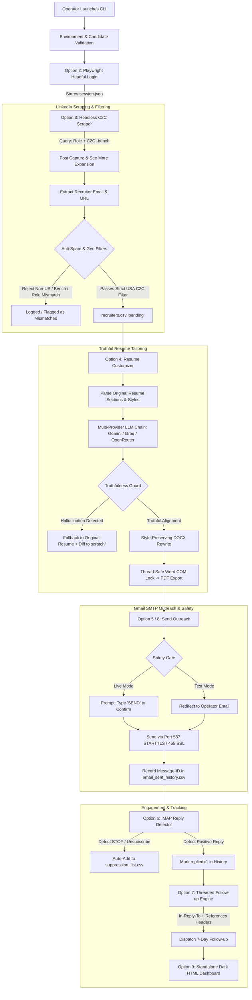

# About The Project: Recruitment & Outreach Automation System

An enterprise-grade Python automation pipeline architected to streamline end-to-end B2B and Corp-to-Corp (C2C) talent marketing in the United States. It connects registered IT consultant candidates with real-time hiring posts on LinkedIn, tailors resumes truthfully with advanced LLM intelligence, dispatches personalized outreach via Gmail SMTP, tracks replies over IMAP, and sends conversational follow-ups.

---

## 📑 Table of Contents
1. [Core Mission & Value Proposition](#core-mission--value-proposition)
2. [End-to-End Pipeline Architecture](#end-to-end-pipeline-architecture)
3. [Deep-Dive Module Breakdown](#deep-dive-module-breakdown)
4. [Safety, Anti-Spam & Reputation Protection](#safety-anti-spam--reputation-protection)
5. [Storage Architecture & Data Schemas](#storage-architecture--data-schemas)
6. [Multi-Provider LLM Fallback Chain](#multi-provider-llm-fallback-chain)
7. [Environment Configuration Reference](#environment-configuration-reference)
8. [CLI Operations & Workflow Guide](#cli-operations--workflow-guide)
9. [Testing & Quality Assurance](#testing--quality-assurance)

---

## 🎯 Core Mission & Value Proposition

In the United States IT staffing market, finding high-quality Corp-to-Corp (C2C) opportunities requires rapid response to hiring announcements. However, traditional manual marketing suffers from significant friction:
- **High Noise & Spam**: Postings are often inundated with bench marketing, consultant hotlists, and non-US agencies.
- **Manual Overhead**: Crafting individualized emails and tailoring resumes to match specific job descriptions takes hours.
- **Reputation Risks**: Careless automated scrapers send hallucinated credentials or contact candidates repeatedly, risking blacklisting.
- **Lost Leads**: Up to 70% of candidate responses occur on follow-ups, which are rarely sent systematically or threaded properly.

The **Recruitment & Outreach Automation System** automates this entire lifecycle with strict human-in-the-loop controls, rigorous truthfulness verification, and enterprise deliverability practices.

---

## 🏗️ End-to-End Pipeline Architecture



---

## 📦 Deep-Dive Module Breakdown

### 1. Central CLI & Orchestrator (`main.py`)
- Built with **Rich** terminal formatting for an elegant, readable operator console.
- Displays interactive status dashboards, progress tables, and safety warnings.
- Supports both modular step-by-step execution and full batch processing (`Option 8`) across all registered candidates.

### 2. Candidate Profiles & Domain Filters (`client_config.py`)
- Central source of truth for candidate metadata:
  - `name`, `email`, `primary_role`, `experience_years`, `skills`, and file paths to original resumes.
- Defines targeted search role variants and specific exclusion keywords.
- Holds comprehensive geographic dictionaries (`USA_STATE_CODES`, `USA_CITIES`) and non-US rejection lists (`Pune`, `Noida`, `India`, `Canada`, etc.).

### 3. Concurrency & COM Mutex (`lock_util.py`)
- Word automation via COM (`winword.exe`) is notoriously fragile under concurrent execution.
- Implements `FileLock`: an inter-process file-based mutex context manager with configurable timeout and stale-lock recovery (verifying process IDs and file modification age).
- Ensures that resume conversions serialize cleanly without corrupting Microsoft Office COM handles.

### 4. Flat CSV Storage & Schema Migrations (`csv_store.py`)
- Manages three primary flat databases:
  - `recruiters.csv`: Harvested hiring opportunities and processing statuses (`pending`, `sent`, `failed`, `mismatched_role`).
  - `email_sent_history.csv`: Full audit trail of outbound communications, including `message_id`, threading headers, follow-up counts, and reply tracking.
  - `suppression_list.csv`: Global opt-out registry honoring "STOP" requests.
- **Atomic File Writes**: Writes all updates to temporary files before replacing targets, preventing corruption during abrupt shutdowns.
- **Automatic Runtime Schema Migration**: Automatically detects missing or outdated CSV headers and migrates columns on startup without data loss.

### 5. LinkedIn Authentication (`linkedin_login.py`)
- Launches a headful Playwright Chromium browser.
- Allows the human operator to solve 2FA, OTP, or CAPTCHA challenges safely.
- Waits for feed navigation and dumps authenticated session cookies and local storage tokens into `session.json`.

### 6. Headless C2C Scraper (`linkedin_scraper.py`)
- Consumes `session.json` to scrape in headless mode without repeating logins.
- Formulates Boolean queries targeting USA C2C postings from the last 24 hours (`geoUrn=103644278`, anti-bench keywords).
- Selects post cards, clicks "See more" to expand full job descriptions, and extracts recruiter emails (`mailto:` protocol priority, followed by strict regex).
- Performs domain-matching to prevent pitching full-stack engineers for Salesforce or QA roles.

### 7. Resume Customizer & Truthfulness Guard (`resume_customizer.py`)
- Converts source resumes (PDF/DOCX) and isolates Summary, Skills, and Experience sections.
- Sends structured requests to the LLM fallback chain.
- **The Mandatory Truthfulness Guard**:
  - Diffs rewritten technologies against original resume skills and JD requirements.
  - If any ungrounded technology, fake company, or fabricated credential is introduced, the system flags the violation, logs a visual diff report to `scratch/`, and falls back to the original verified resume.
- Preserves paragraph formatting, bold tags, font families, font sizes, and color styling run-by-run in Word DOCX.

### 8. Multi-Provider LLM Orchestrator (`llm_client.py`)
- Orchestrates resilient API communication across a configurable provider chain:
  $$\text{Gemini (Primary)} \longrightarrow \text{Groq (Fallback 1)} \longrightarrow \text{OpenRouter (Fallback 2)}$$
- Enforces strict JSON schema validation for resume tailoring.
- Provides freeform text generation for follow-up value hooks.
- Configurable models: defaults to modern versions (`gemini-3.8-flash`, `llama-3.3-70b-versatile`).

### 9. Gmail SMTP Engine (`gmail_sender.py`)
- Dispatches personalized outreach through Gmail SMTP servers.
- Dual-connection resilience: Attempts Port 587 (`STARTTLS`) with automatic fallback to Port 465 (`SSL`).
- Dynamically pairs candidate skills with 60+ curated technology keywords in the job description to write relevant opening hooks.
- Attaches the tailored resume with sanitized filenames (`Candidate_Resume_<timestamp>.pdf`).
- Records standard `Message-ID` headers to enable threading in follow-ups.

### 10. IMAP Reply Detector & Auto-Suppression (`imap_reply_detector.py`)
- Connects securely to `imap.gmail.com:993` in **read-only mode** (`BODY.PEEK[HEADER]`).
- Scans INBOX for recruiter responses linked to past outreach campaigns.
- Automatically marks records as `replied=1` in `email_sent_history.csv`.
- Analyzes message bodies for opt-out intent (`STOP`, `UNSUBSCRIBE`, `REMOVE`). If detected, immediately registers the address in `suppression_list.csv`.

### 11. Threaded Follow-up Engine (`followup_sender.py`)
- Identifies outreach sent $\ge 7$ days ago that remains unreplied and unsuppressed.
- Injects standard RFC conversation threading headers:
  - `In-Reply-To: <original-message-id>`
  - `References: <original-message-id>`
  - Subject: `Re: <original-subject>`
- Re-attaches candidate resume and appends a concise AI-generated value proposition.

### 12. Dark-Themed Analytics Dashboard (`analytics.py`)
- Calculates key conversion metrics: Total Scraped, Emails Sent, Replies Received, Reply Rate %, and Follow-up Volume.
- Generates a standalone, beautiful HTML dashboard (`analytics_report.html`) styled with a modern dark theme and zero external CDN dependencies.

---

## 🛡️ Safety, Anti-Spam & Reputation Protection

| Guard Feature | Implementation | Purpose |
| :--- | :--- | :--- |
| **Mandatory SEND Confirmation** | Interactive prompt in `main.py` | Prevents accidental mass email dispatches in production. Requires operator to review recipients and type `SEND`. |
| **Safe Test Mode** | `TEST_MODE=true` in `.env` | Redirects all outreach emails to the operator address while recording realistic headers for verification. |
| **Truthfulness Guard** | Text diff validation in `resume_customizer.py` | Automatically rejects AI-hallucinated skills and falls back to original resume, saving `.diff` files to `scratch/`. |
| **Suppression Enforcement** | `suppression_list.csv` checks | Guarantees any recruiter who requests to opt out is never emailed again. |
| **Opt-Out Notice** | Mandatory email footer | Appends `"Reply STOP to opt out"` to all cold communications. |
| **Rate Limiting** | Inter-email delays (3s) + daily cap | Mimics human delivery velocity and protects Gmail account sender reputation. |
| **De-duplication** | Unique `(candidate, recruiter_email)` lookup | Ensures candidates are never pitched to the same recruiter multiple times for the same campaign. |

---

## 📊 Storage Architecture & Data Schemas

### `recruiters.csv`
Harvested leads discovered during scraping:
```csv
recruiter_name,recruiter_email,role,post_url,job_description,email_sent_status,timestamp
```
- `email_sent_status` values: `pending`, `sent`, `failed`, `mismatched_role`.

### `email_sent_history.csv`
Audit log of all outreach attempts and conversational state:
```csv
recruiter_name,recruiter_email,role,post_url,candidate,email_sent_status,timestamp,subject,message_id,followup_count,last_followup_at,replied
```

### `suppression_list.csv`
Blacklist of opted-out or unsubscribed contacts:
```csv
email,reason,timestamp
```

---

## ⚙️ Environment Configuration Reference

All settings are managed via `.env`. A complete template is provided in `.env.example`:

| Environment Variable | Description | Example / Default |
| :--- | :--- | :--- |
| `GEMINI_API_KEY` | Google Gemini API Key | `AIzaSy...` |
| `GEMINI_MODEL` | Gemini Model identifier | `gemini-3.8-flash` |
| `GROQ_API_KEY` | Groq API Key | `gsk_...` |
| `GROQ_MODEL` | Groq Model identifier | `llama-3.3-70b-versatile` |
| `OPENROUTER_API_KEY` | OpenRouter API Key (optional fallback) | `sk-or-v1-...` |
| `OPENROUTER_MODEL` | OpenRouter Model identifier | `meta-llama/llama-3.1-8b-instruct:free` |
| `LLM_PROVIDER_CHAIN` | Comma-separated provider execution order | `gemini,groq,openrouter` |
| `GMAIL_EMAIL` | Sender Gmail address | `user@gmail.com` |
| `GMAIL_APP_PASSWORD` | 16-character Google App Password | `abcd efgh ijkl mnop` |
| `OPERATOR_EMAIL` | Operator address for receiving test mode emails | `operator@company.com` |
| `TEAM_LEAD_EMAIL` | Recipient address for CC field | `lead@company.com` |
| `ADMIN_BCC_EMAIL` | Archive address for BCC field | `archive@company.com` |
| `TEST_MODE` | If `true`, redirects outreach to operator | `true` |
| `GLOBAL_DAILY_LIMIT` | Maximum cold emails dispatched per 24 hours | `50` |
| `INTER_EMAIL_DELAY_SEC`| Delay between sequential email dispatches | `3` |
| `FOLLOWUP_DAYS` | Threshold days before eligible for follow-up | `7` |
| `IMAP_SYNC_DAYS` | Date window for historical IMAP header checks | `30` |

---

## 🚀 CLI Operations & Workflow Guide

### 1. Launch the System
```bash
python main.py
```

### 2. Available CLI Menu Options
1. **Setup & Environment Validation**: Audits `.env` credentials, API connectivity status, and candidate files.
2. **Setup/Test LinkedIn Session**: Opens a headful browser for manual login and saves `session.json`.
3. **Scrape LinkedIn C2C Jobs**: Executes targeted search for USA C2C postings and parses recruiter emails into `recruiters.csv`.
4. **Tailor Resumes for Pending Jobs**: Extracts job descriptions, customizes resume content using the LLM chain, verifies truthfulness, and exports tailored PDFs.
5. **Send Outreach Emails**: Dispatches pending emails via Gmail SMTP with mandatory operator review.
6. **Sync IMAP Recruiter Replies**: Scans Gmail inbox for responses and synchronizes `replied` flags and suppression lists.
7. **Process Threaded Follow-ups**: Scans eligible 7-day-old emails and sends threaded follow-ups with AI value hooks.
8. **Run Full Pipeline for ALL Candidates**: Completely automated batch pipeline running scraping, tailoring, outreach, and reply sync across all candidate profiles.
9. **Export Analytics Dashboard**: Generates the standalone `analytics_report.html` file.
0. **Exit**: Gracefully terminates execution.

---

## 🧪 Testing & Quality Assurance

The codebase includes comprehensive unit and integration tests under `tests/`, designed to execute completely offline with all external services mocked:

```bash
pytest
```

Output:
```text
============================= test session starts =============================
platform win32 -- Python 3.11.9, pytest-9.1.1, pluggy-1.6.0
configfile: pytest.ini
testpaths: tests
plugins: anyio-4.13.0, mock-3.17.0
collected 50 items

tests\test_analytics.py ...                                              [  6%]
tests\test_client_config.py ...                                          [ 12%]
tests\test_csv_store.py ......                                           [ 24%]
tests\test_followup_and_imap.py .....                                    [ 34%]
tests\test_gmail_sender.py ........                                      [ 50%]
tests\test_linkedin_scraper.py ..........                                [ 70%]
tests\test_lock_util.py ......                                           [ 82%]
tests\test_main_cli.py ..                                                [ 86%]
tests\test_resume_customizer.py .......                                  [100%]

============================= 50 passed in 4.79s ==============================
```

---

## 📝 License & Compliance
This software is intended for professional B2B marketing and talent representation. Operators must ensure compliance with:
- Google Mail Sending Guidelines and Terms of Service.
- LinkedIn Professional Community Policies and User Agreements.
- CAN-SPAM Act requirements (accurate headers, valid physical address, and functional opt-out mechanisms).
