# Recruitment & Outreach Automation System

A command-line pipeline that automates C2C (Corp-to-Corp) contract outreach to US recruiters on behalf of registered client candidates. It scrapes LinkedIn hiring posts, tailors a resume to each job description with an LLM, sends personalized emails through Gmail, follows up in-thread, syncs replies over IMAP, and reports on results.

This document describes the architecture and the flow of **every component** in enough detail for an engineering team to rebuild, modify or extend the system.

---

## Table of Contents

1. [Overview and Goals](#1-overview-and-goals)
2. [High-Level Architecture](#2-high-level-architecture)
3. [End-to-End Sequence](#3-end-to-end-sequence)
4. [Repository Layout](#4-repository-layout)
5. [Data Layer](#5-data-layer)
6. [Component Reference](#6-component-reference)
   - [6.1 main.py: CLI orchestrator](#61-mainpy-cli-orchestrator)
   - [6.2 client_config.py: configuration registry](#62-client_configpy-configuration-registry)
   - [6.3 linkedin_login.py: session bootstrap](#63-linkedin_loginpy-session-bootstrap)
   - [6.4 linkedin_scraper.py: scraping engine](#64-linkedin_scraperpy-scraping-engine)
   - [6.5 gmail_sender.py: outreach sender](#65-gmail_senderpy-outreach-sender)
   - [6.6 resume_customizer.py: AI resume customizer](#66-resume_customizerpy-ai-resume-customizer)
   - [6.7 Client-specific customizers](#67-client-specific-customizers)
   - [6.8 lock_util.py: Word COM mutex](#68-lock_utilpy-word-com-mutex)
   - [6.9 followup_sender.py: threaded follow-ups](#69-followup_senderpy-threaded-follow-ups)
   - [6.10 imap_reply_detector.py: reply sync](#610-imap_reply_detectorpy-reply-sync)
   - [6.11 analytics.py: reporting](#611-analyticspy-reporting)
7. [LLM Provider Strategy](#7-llm-provider-strategy)
8. [Operational Workflows](#8-operational-workflows)
9. [Installation and Configuration](#9-installation-and-configuration)
10. [Extending the System](#10-extending-the-system)
11. [Troubleshooting](#11-troubleshooting)
12. [Known Limitations and Risks](#12-known-limitations-and-risks)

---

## 1. Overview and Goals

The system runs in **Client Application Mode**: it manages C2C contract outreach for registered client candidates, each defined in `client_config.py` with a profile, target roles and resume templates.

| # | Goal | Summary |
|---|------|---------|
| 1 | Targeted scraping | Search LinkedIn for hiring posts matching a candidate's roles (for example Java Developer, Data Scientist) from the last 24 hours and isolate recruiter emails. |
| 2 | Strict filtering | Exclude bench marketers, non-US locations and mismatched domains (for example QA roles for a developer profile). |
| 3 | AI resume customization | Use Gemini, Groq or OpenRouter to align a client's Word or PDF resume with the job description while preserving formatting. |
| 4 | Cold outreach dispatch | Send personalized Gmail SMTP emails with a hook built from keywords in the job description. |
| 5 | Threaded follow-ups | After X days without a reply, send a follow-up that threads under the original email using `In-Reply-To`. |
| 6 | IMAP reply sync | Scan the Gmail inbox for replies and update the local database. |
| 7 | Analytics reporting | Track outreach statistics and export a dark-themed HTML dashboard. |

---

## 2. High-Level Architecture

The system has four layers: an operator interface, a set of pipeline workers, a flat-file data layer, and external services.

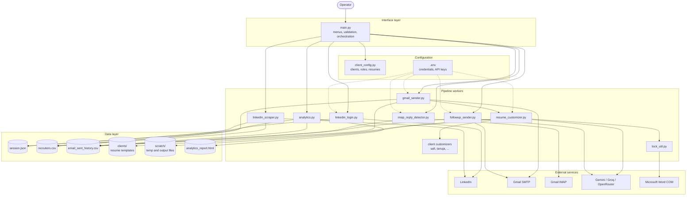

### Design principles

- **CLI-driven and operator-gated.** Sending requires the operator to type `SEND`.
- **Flat-file state.** CSV files act as the database; headers are checked and migrated at runtime.
- **Pluggable resume handling.** A default customizer handles standard layouts and per-client customizers handle unusual ones.
- **Provider fallback.** LLM calls fall back across providers instead of failing the run.
- **Serialized Word access.** A file-based mutex protects the Windows COM interface.

---

## 3. End-to-End Sequence

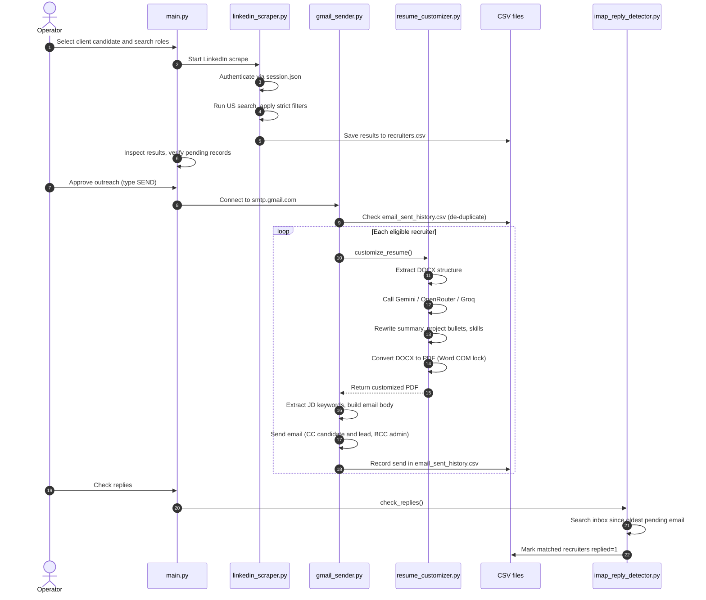

---

## 4. Repository Layout

```
.
├── main.py                    # CLI entry point and orchestrator
├── client_config.py           # Candidate profiles, roles, exclusions, resume lists
├── linkedin_login.py          # Headful login, writes session.json
├── linkedin_scraper.py        # Playwright scraper and filters
├── gmail_sender.py            # SMTP sender, hook builder, dispatcher
├── resume_customizer.py       # Default AI resume customizer and PDF conversion
├── safi_customizer.py         # Client-specific customizer
├── tanuja_customizer.py       # Client-specific customizer
├── followup_sender.py         # Threaded follow-ups
├── imap_reply_detector.py     # Inbox scan, reply sync
├── analytics.py               # Statistics and HTML report
├── lock_util.py               # File-based mutex for Word COM
├── session.json               # Playwright state (generated)
├── recruiters.csv             # Scraped recruiter records (generated)
├── email_sent_history.csv     # Outreach history (generated)
├── analytics_report.html      # Dashboard (generated)
├── clients/                   # Resume templates per candidate
├── scratch/                   # Temporary conversions and customized output
├── requirements.txt
└── .env                       # Secrets (never commit)
```

---

## 5. Data Layer

State lives in two CSV files plus a Playwright session file. At runtime the system compares headers against the expected schema and migrates them to prevent schema drift.

### 5.1 `recruiters.csv`: scraped contacts

| Field | Type | Description |
|-------|------|-------------|
| `recruiter_name` | String | Name taken from the recruiter's LinkedIn profile link (`/in/`). |
| `recruiter_email` | String | Email found in the post body. |
| `role` | String | Target role the post matched; used for resume resolution. |
| `post_url` | String | Link to the LinkedIn post. |
| `job_description` | String | Raw post text. |
| `email_sent_status` | String | `pending`, `sent`, `failed` or `mismatched_role`. |
| `timestamp` | String | Scrape time, `YYYY-MM-DD HH:MM:SS`. |

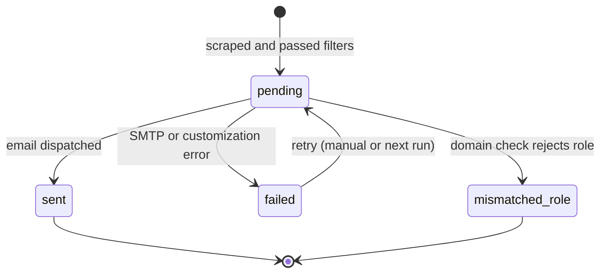

### 5.2 `email_sent_history.csv`: outreach log

| Field | Type | Description |
|-------|------|-------------|
| `recruiter_name` | String | Recruiter's name. |
| `recruiter_email` | String | Recruiter's email. Primary key for de-duplication. |
| `role` | String | Role applied for. |
| `post_url` | String | Reference post URL. |
| `candidate` | String | Client candidate who applied. |
| `email_sent_status` | String | `sent`, `failed`, etc. |
| `timestamp` | String | When the email was dispatched. |
| `subject` | String | Subject line sent. |
| `message_id` | String | SMTP Message-ID, used for follow-up threading. |
| `followup_count` | Integer | Number of follow-ups sent (default `0`). |
| `last_followup_at` | String | Time of the latest follow-up. |
| `replied` | Integer | `0` no reply, `1` reply detected. |

### 5.3 Who reads and writes what

| Component | `recruiters.csv` | `email_sent_history.csv` | `session.json` |
|-----------|:----------------:|:------------------------:|:--------------:|
| `linkedin_login.py` | | | write |
| `linkedin_scraper.py` | write | read (skip known contacts) | read |
| `gmail_sender.py` | read, update status | read (de-dup), write | |
| `followup_sender.py` | | read, update | |
| `imap_reply_detector.py` | | read, update `replied` | |
| `analytics.py` | read | read | |

> **Concurrency note:** CSV files have no locking. Run one pipeline process at a time against the same files.

---

## 6. Component Reference

Each component below lists its purpose, inputs and outputs, internal flow, and failure behavior.

### 6.1 `main.py`: CLI orchestrator

**Purpose.** Interactive entry point that provides terminal menus, validates setup, orchestrates the pipeline and runs automated batches. Built with `rich` for terminal UI.

**Inputs.** Operator menu choices, `client_config.py`, `.env`.
**Outputs.** Calls into the scraper, sender, follow-up sender, IMAP detector and analytics module.

**Known menu options** (from the spec; other options exist but are not documented there):

| Option | Action |
|--------|--------|
| 2 | Setup/Test LinkedIn login session |
| 8 | Run full pipeline for all candidates (automated batch mode) |

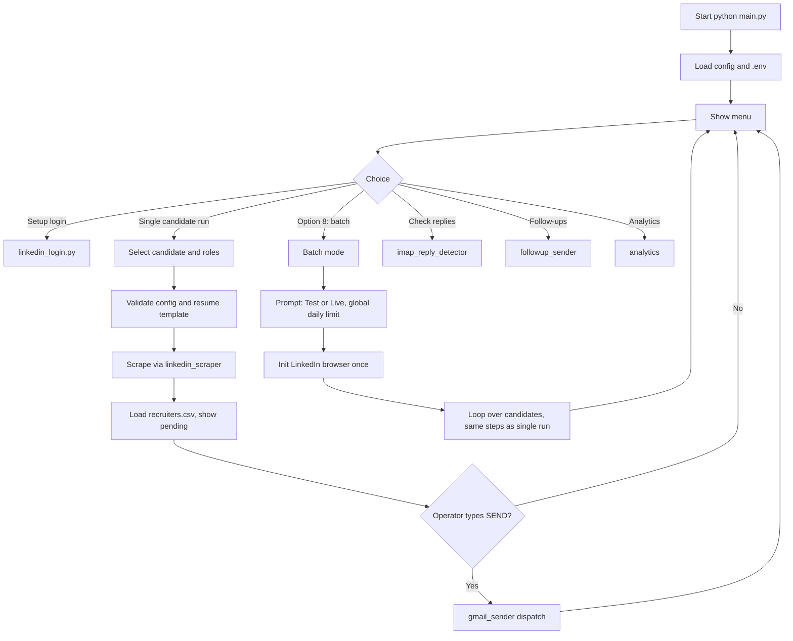

**Responsibilities in detail**

1. **Setup validation.** Confirms required `.env` values, the presence of `session.json`, and that each candidate's resume template files exist.
2. **Pipeline orchestration.** Sequences scrape, review, customize, send and log.
3. **Approval gate.** Requires the literal `SEND` confirmation before any live email goes out.
4. **Batch mode.** See [section 8.2](#82-automated-batch-processing).

**Failure behavior.** Validation failures stop the candidate's run with a message rather than sending partial output.

---

### 6.2 `client_config.py`: configuration registry

**Purpose.** Single source of truth for who the system acts for and what it searches.

**Contents**

| Structure | Purpose |
|-----------|---------|
| `CLIENTS` | Candidate profile: name, email, phone, LinkedIn URL, location, relocation, work authorization, availability, experience, resume file list (`resume_candidates`). |
| `CANDIDATE_ROLES` | Per candidate: `primary_role`, `search_roles`, `exclusion_keywords`. |
| C2C exclusion lists | Keywords that remove spam such as `hotlist`, `fulltime`, `available consultants`. |
| Resume assets | Paths to templates in `clients/`. |

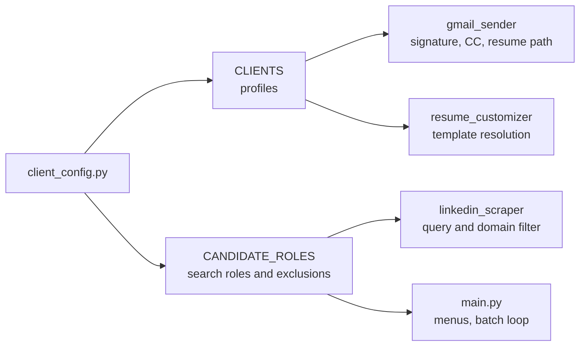

---

### 6.3 `linkedin_login.py`: session bootstrap

**Purpose.** Establishes an authenticated LinkedIn session once so that later scrapes run headlessly.

**Inputs.** `LINKEDIN_EMAIL`, `LINKEDIN_PASSWORD`, manual operator input for security prompts.
**Outputs.** `session.json` (cookies and local storage).

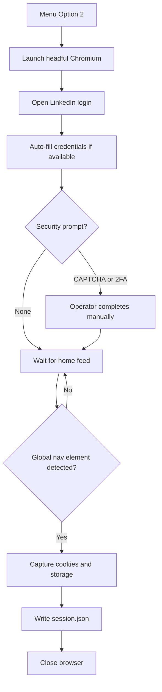

**Notes.** The session file expires with the LinkedIn cookies. If scraping starts returning login walls, repeat this flow. Treat `session.json` as a credential.

---

### 6.4 `linkedin_scraper.py`: scraping engine

**Purpose.** Uses Playwright Chromium to find recruiter posts, extract emails and the post URL, and apply strict filters.

**Inputs.** `session.json`, candidate roles and exclusions from `client_config.py`.
**Outputs.** New rows in `recruiters.csv` with `email_sent_status = pending` (or `mismatched_role`).

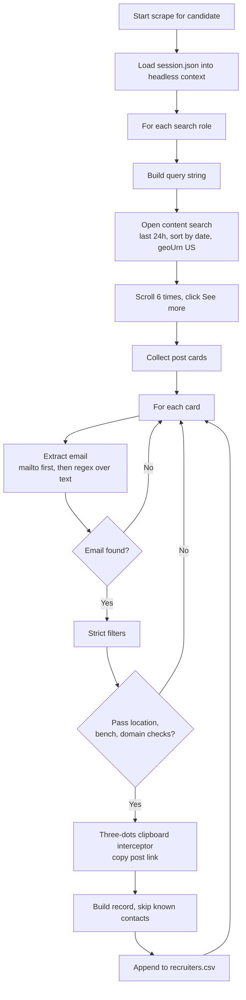

**Step details**

1. **Query construction.** Format: `"<Role> + C2C -hotlist -fulltime -\"available consultants\" -Bench"`.
2. **Pagination and scroll.** Filters are last 24 hours, sorted by date, geo-targeted to the United States (`geoUrn=103644278`). The scraper scrolls 6 times and force-clicks "See more" selectors so truncated posts expand.
3. **Three-dots clipboard interceptor.** LinkedIn hides direct post links, so for each card the scraper:
   1. Scrolls the card to the center of the viewport.
   2. Clicks the post control menu (`button[aria-label*='control menu for post']`).
   3. Clicks the "Copy link" option.
   4. Clears then reads the clipboard in the page context: `navigator.clipboard.writeText('')` followed by `navigator.clipboard.readText()`.
   5. Strips query parameters and maps the clean URL back to the card.
4. **Email extraction.** Checks `mailto:` links first, then splits text nodes on whitespace and matches `[a-zA-Z0-9._%+-]+@[a-zA-Z0-9.-]+\.[a-zA-Z]{2,}`.
5. **Strict filters** (`matches_strict_filter`, `is_usa_job`):

| Filter | Rule |
|--------|------|
| Location | Reject if text matches `NON_USA_INDICATORS` (for example Pune, Noida, India, Canada). Accept major US cities, state abbreviations (for example `Dallas, TX`) or explicit US terms. |
| Bench marketing | Reject phrases such as "on my bench", "candidate available", "marketing my consultant". |
| Domain mismatch | Parse the declared job title from the post lines; reject posts whose title targets domains (DevOps, QA, Salesforce, etc.) that do not align with the candidate's target roles. Rejected rows may be recorded as `mismatched_role`. |

**Failure modes.** UI selector changes (the control-menu and "Copy link" selectors are the most fragile), expired session, clipboard permission denial in headless mode, and LinkedIn rate limits or restrictions.

---

### 6.5 `gmail_sender.py`: outreach sender

**Purpose.** Establishes the SMTP connection, personalizes each email, attaches the customized resume, sends, and logs.

**Inputs.** Pending rows from `recruiters.csv`, `email_sent_history.csv` (de-dup), candidate profile, `GMAIL_EMAIL`, `GMAIL_APP_PASSWORD`.
**Outputs.** Sent emails, new rows in `email_sent_history.csv`, updated status in `recruiters.csv`.

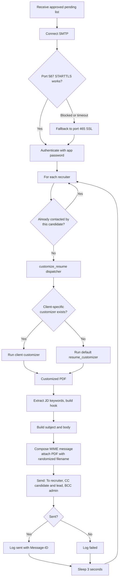

**Key behaviors**

| Behavior | Detail |
|----------|--------|
| Dynamic hook | Matches the job description against 60+ technology keywords (`JD_KEYWORDS`), selects the top 3, and builds a sentence such as "My hands-on experience with Java, Spring Boot, and PostgreSQL maps directly to what you are looking for...". |
| SMTP negotiation | `smtp.gmail.com:587` with STARTTLS first; on block or timeout, `smtp.gmail.com:465` with SSL. |
| De-duplication | Checks `email_sent_history.csv` for existing candidate and recruiter pairs before sending. |
| Anti-throttling | 3-second sleep between consecutive emails. |
| MIME composition | Attaches the PDF as `CandidateName_Resume_<unix timestamp>.pdf` so Gmail does not serve a cached preview, and sanitizes non-ASCII characters to avoid "noname" attachments. |
| Recipients | To the recruiter, CC the client candidate and team lead, BCC the admin. |
| Dispatcher | Hosts `customize_resume()`, which routes to a client-specific customizer when one exists. |
| Modes | Test and Live sending modes are selected in `main.py`. |

---

### 6.6 `resume_customizer.py`: AI resume customizer

**Purpose.** Reads a resume template, aligns it with the job description using an LLM, writes a tailored copy while preserving styling, and converts it to PDF.

**Inputs.** Resume template (`.docx` or `.pdf`), job description, LLM API keys.
**Output.** A tailored PDF in `scratch/`.

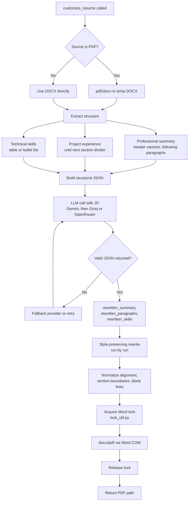

**Stage details**

1. **Format conversion.** PDF sources are converted to a temporary `.docx` with `pdf2docx`, which extracts the structural layers.
2. **Structure extraction.**
   - *Professional summary:* finds headers matching variants such as `PROFESSIONAL SUMMARY` or `SUMMARY` and takes all following paragraphs.
   - *Project experience:* takes paragraphs after headings matching projects or experience, up to the next divider such as `EDUCATION`.
   - *Technical skills:* detects tables or bullet lists.
3. **AI tailoring.** Sends JSON arrays to the LLM. The prompt asks it to rewrite the summary, experience paragraphs and skills, weaving key JD technologies into each project 2 to 3 times while maintaining historical context. Output is constrained to JSON with `rewritten_summary`, `rewritten_paragraphs` and `rewritten_skills`.
4. **Style-preserving rewrite.** Walks document paragraphs and table cells and overwrites text nodes run by run. It preserves each run's font name, size, bold, italic, underline and color, plus paragraph styles. It then fixes alignment and continuous section boundaries and removes consecutive blank spacing.
5. **PDF compilation.** `docx2pdf` drives Word over COM on Windows. Hung Word instances are killed with `taskkill /f /im winword.exe`. `lock_util.py` serializes access so threads never use COM concurrently.

> **Quality guard recommended:** because the prompt asks the model to weave JD technologies into project bullets, validate output against the original resume (see [section 12](#12-known-limitations-and-risks)) before sending.

---

### 6.7 Client-specific customizers

**Purpose.** Handle resumes whose layout the default parser cannot process cleanly (custom tables, margins, unusual headers).

**Examples.** `safi_customizer.py`, `tanuja_customizer.py`.

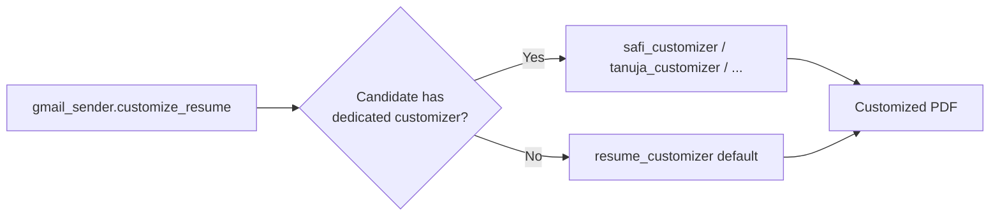

**Contract.** A client customizer receives the same inputs as the default (template path, job description, candidate context) and must return a PDF path. It should reuse the shared LLM call and Word lock utilities rather than reimplement them. See [section 10.2](#102-handle-an-unusual-resume-layout).

---

### 6.8 `lock_util.py`: Word COM mutex

**Purpose.** Prevent crashes caused by concurrent access to the Windows Word COM interface.

**Mechanism.** A thread-safe, file-based lock. A worker acquires the lock before DOCX-to-PDF conversion and releases it afterward, so only one conversion runs at a time.

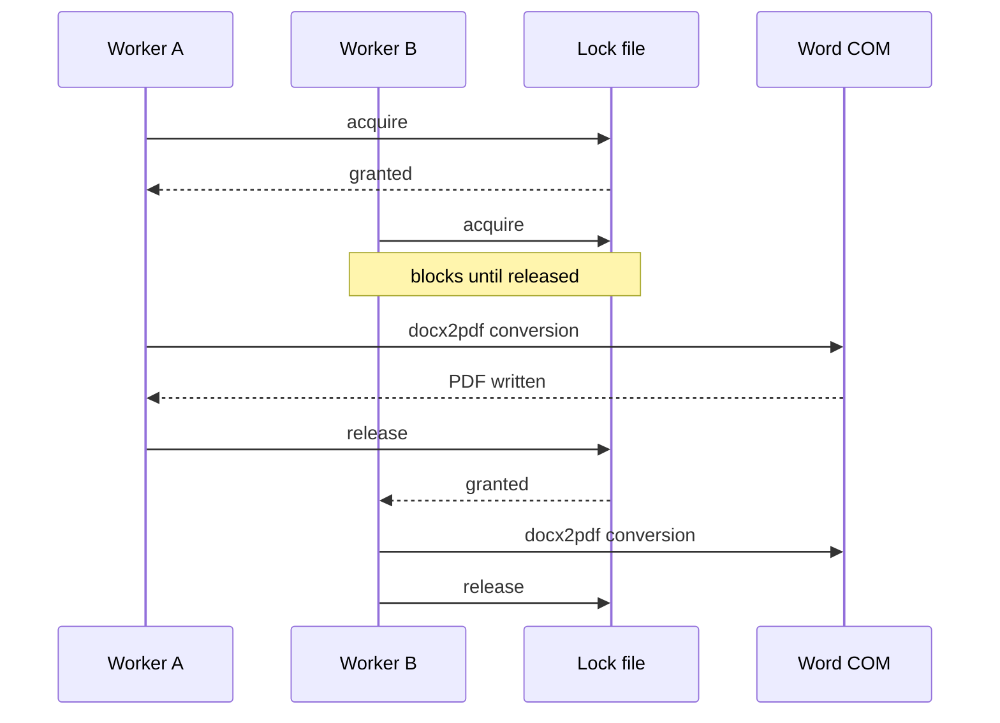

**Operational note.** A crashed process can leave a stale lock file; remove it manually if conversions hang with no Word process running.

---

### 6.9 `followup_sender.py`: threaded follow-ups

**Purpose.** Nudge recruiters who have not replied, keeping the message inside the original Gmail thread.

**Inputs.** `email_sent_history.csv`, candidate profile, OpenRouter API key, SMTP credentials.
**Outputs.** Follow-up emails; updated `followup_count` and `last_followup_at`.

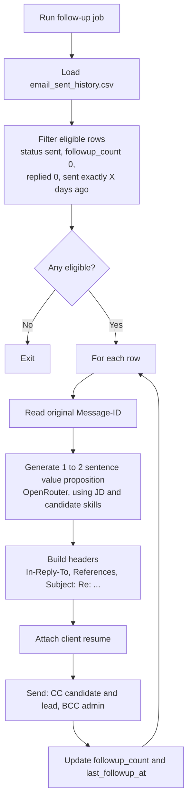

**Threading details**

```
In-Reply-To: <original_message_id>
References:  <original_message_id>
Subject:     Re: <original subject>
```

These headers make Gmail attach the follow-up directly beneath the original outreach. Eligibility uses a default of **7 days**, configurable as X.

**Dependency.** Replies must be synced first (see [6.10](#610-imap_reply_detectorpy-reply-sync)); otherwise recruiters who already replied can still receive a follow-up.

---

### 6.10 `imap_reply_detector.py`: reply sync

**Purpose.** Keep the local database aligned with the inbox so follow-ups and analytics reflect reality.

**Inputs.** `GMAIL_EMAIL`, `GMAIL_APP_PASSWORD`, `email_sent_history.csv`.
**Output.** `replied = 1` for matched recruiters.

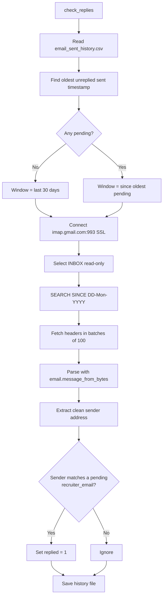

**Notes.** The inbox is opened read-only, so no messages are altered. Matching is by sender email address, so replies from a different address at the same company will not be detected.

---

### 6.11 `analytics.py`: reporting

**Purpose.** Compute pipeline statistics and export a dark-themed HTML dashboard to `analytics_report.html`.

**Inputs.** `recruiters.csv`, `email_sent_history.csv`.
**Output.** `analytics_report.html`.

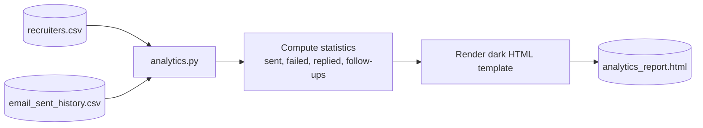

> The source spec states the purpose and output but not the exact metrics; typical measures derivable from the schema are totals by status, reply rate (`replied` over `sent`), follow-up counts, and volume per candidate or role.

---

## 7. LLM Provider Strategy

| Use | Primary | Fallback |
|-----|---------|----------|
| Resume customization | Gemini (`GEMINI_MODEL`, default `gemini-2.0-flash`) | Groq (`GROQ_MODEL`), OpenRouter (`OPENROUTER_MODEL`) |
| Follow-up value proposition | OpenRouter | Groq (secondary) |

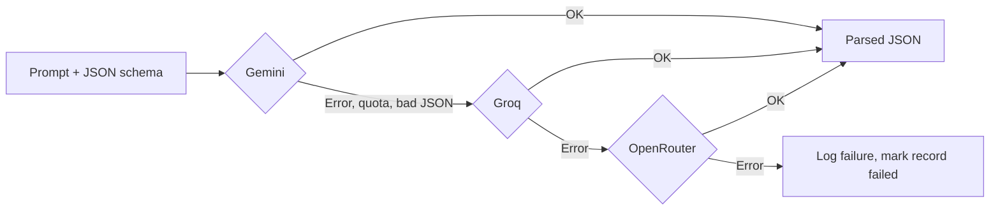

---

## 8. Operational Workflows

### 8.1 First-time authentication

1. Run `python main.py`.
2. Choose **Option 2** (Setup/Test LinkedIn Login Session).
3. A headful browser opens; enter credentials if not auto-filled.
4. Complete any CAPTCHA or 2FA prompts.
5. Once the home feed loads, the script detects the global navigation element, saves cookies to `session.json` and closes the browser.
6. Later scrapes run headlessly with this session.

### 8.2 Automated batch processing

**Option 8** runs the full pipeline for every candidate.

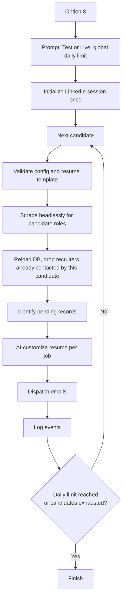

### 8.3 Daily operating routine (suggested)

| Step | Action |
|------|--------|
| 1 | Run reply sync (IMAP) so status is current. |
| 2 | Run follow-ups for records at the X-day mark. |
| 3 | Run scrape and outreach (single candidate or batch). |
| 4 | Export analytics and review. |

---

## 9. Installation and Configuration

### 9.1 Requirements

- **OS:** Windows (required for Word COM and `docx2pdf`)
- **Python:** 3.10+
- **Microsoft Word:** installed and licensed

### 9.2 Install

```bash
pip install -r requirements.txt
playwright install
```

`requirements.txt`:

```
playwright>=1.40.0
pandas>=2.0.0
python-dotenv>=1.0.0
beautifulsoup4>=4.12.0
rich>=13.0.0
pypdf>=3.17.0
python-docx>=1.0.0
pdf2docx>=0.5.6
docx2pdf>=0.1.8
requests>=2.31.0
```

### 9.3 Environment variables (`.env`)

```ini
# --- LinkedIn ---
LINKEDIN_EMAIL=your_linkedin_email@example.com
LINKEDIN_PASSWORD=your_linkedin_password

# --- Gmail (SMTP/IMAP) ---
# Use a Gmail App Password (Google Account > Security > 2-Step Verification)
GMAIL_EMAIL=your_gmail_address@gmail.com
GMAIL_APP_PASSWORD=abcd efgh ijkl mnop

# --- AI providers ---
# Primary model for customization
GEMINI_API_KEY=your_gemini_key
GEMINI_MODEL=gemini-2.0-flash
# Fallback for value propositions
OPENROUTER_API_KEY=your_openrouter_key
OPENROUTER_MODEL=meta-llama/llama-3.3-70b-instruct:free
# Secondary fallback
GROQ_API_KEY=your_groq_key
GROQ_MODEL=llama-3.3-70b-versatile
```

Add `.env`, `session.json`, `recruiters.csv`, `email_sent_history.csv` and `clients/` to `.gitignore`.

---

## 10. Extending the System

### 10.1 Add a client candidate

Edit `client_config.py`.

**Target roles** under `CANDIDATE_ROLES`:

```python
"new_candidate": {
    "primary_role": "React Developer",
    "search_roles": ["React Developer", "Frontend Engineer", "UI Developer"],
    "exclusion_keywords": ["hotlist", "fulltime", "available consultants"],
}
```

**Profile** under `CLIENTS`:

```python
"new_candidate": {
    "name": "Jane Doe",
    "email": "janedoe@example.com",
    "phone": "555-019-2834",
    "linkedin": "https://www.linkedin.com/in/janedoe",
    "location": "Dallas, TX",
    "relocation": "Yes",
    "work_auth": "H1B",
    "availability": "Immediate",
    "experience": "5+ Years",
    "resume_candidates": ["clients/jane_doe_resume.docx"],
}
```

Then place the resume file in `clients/`.

### 10.2 Handle an unusual resume layout

1. Create `jane_customizer.py`.
2. Implement parsing and writing methods for that document structure (model it on `safi_customizer.py`).
3. Import it and hook it into the `customize_resume()` dispatcher in `gmail_sender.py`.
4. Reuse the shared LLM call and Word lock; return a PDF path.

### 10.3 Add a search role or exclusion

Add the role to `search_roles` or a term to `exclusion_keywords` for that candidate. The scraper builds the query and the domain filter from these lists.

---

## 11. Troubleshooting

| Symptom | Likely cause | Fix |
|---------|--------------|-----|
| Scraper returns nothing | Expired session or UI selector change | Re-run Option 2; inspect the control-menu and "Copy link" selectors. |
| Post URLs empty | Clipboard permission blocked in headless mode | Grant clipboard permissions in the Playwright context or run headful to debug. |
| SMTP auth fails | Normal account password used | Generate a Gmail App Password with 2-Step Verification enabled. |
| SMTP times out on 587 | Network or ISP block | The sender falls back to 465/SSL; check firewall rules. |
| PDF conversion hangs | Stale Word process or lock file | `taskkill /f /im winword.exe`; delete stale lock file. |
| Attachment shows as "noname" | Non-ASCII characters in filename | Use the sanitized randomized filename path. |
| LLM output not parseable | Provider returned non-JSON | Fallback chain retries; check model name and quota. |
| Follow-up sent to someone who replied | Replies not synced | Run IMAP reply check before follow-ups. |
| Schema errors in CSV | Manual edits changed headers | Restore headers; the runtime migration will add missing columns. |

---

## 12. Known Limitations and Risks

| Area | Issue | Suggested mitigation |
|------|-------|----------------------|
| LinkedIn terms of service | Automated scraping with a logged-in session violates LinkedIn's terms; accounts can be restricted or banned, and selectors break when the UI changes. | Prefer sanctioned sources (job-board APIs, recruiter-provided inboxes); keep volume low; monitor selector health. |
| Resume accuracy | Weaving JD technologies into each project 2 to 3 times can fabricate experience the candidate lacks. | Constrain the prompt to technologies already in the resume, validate output against the original, and add a human review step before sending. |
| Deliverability and compliance | Cold email from personal Gmail accounts hits sending limits and spam filters; there is no unsubscribe or opt-out handling (CAN-SPAM). | Add opt-out handling and a suppression list; respect Gmail limits; use proper sending infrastructure for volume. |
| Storage | Flat CSV files are prone to race conditions in concurrent runs. | Migrate to SQLite with transactions. |
| Platform | Word COM ties deployment to Windows with licensed Word. | Replace with LibreOffice headless or a docx-to-PDF library. |
| Secrets | LinkedIn credentials and Gmail app passwords are stored in plaintext `.env` files. | Use a secrets manager or OS keychain; keep credentials out of repos and backups. |
